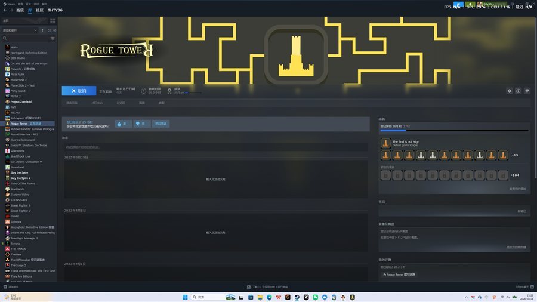

# Rogue Tower 中文汉化补丁

《Rogue Tower》（Steam）的非官方简体中文汉化。**BepInEx 运行时翻译方案**：
游戏资源文件保持英文原版，插件在文本渲染入口实时翻译——覆盖主菜单、升级卡、
怪物图鉴、炮塔说明、新手提示、墓志铭彩蛋、战斗台词等 1700+ 条词条，
并自动切换系统中文字体（微软雅黑），渲染清晰无乱码。

**游戏内右上角有 `中/EN` 按钮，随时一键切换中英文。**

**使用流程**：Steam 安装好游戏 → 拉取本仓库 → 双击一键脚本，即可完成汉化并启动游戏。



## 快速开始

1. 在 Steam 上安装并**至少运行过一次**《Rogue Tower》
2. 拉取本仓库：
   ```
   git clone https://github.com/thty36/rogue-tower-chinese.git
   ```
3. 双击仓库目录里的 **`一键汉化启动.bat`**

脚本会自动完成：

- 定位游戏安装目录（读取 Steam 库配置，无需手动填路径）
- 首次运行时联网安装 Python 依赖（约 1 分钟）
- 若曾用旧版"资源汉化"，自动从备份还原英文原版
- 安装 BepInEx 5 (x86) + 语言切换插件（离线，文件都在仓库里）
- 通过 Steam 启动游戏（成就、创意工坊均不受影响）

再次双击脚本会直接启动游戏。

## 环境要求

- Windows + Steam 版 Rogue Tower（AppID 1843760）
- Python 3.8+（[python.org](https://www.python.org/downloads/) 安装时勾选 *Add to PATH*）
- 首次运行需要联网（仅安装 Python 依赖；汉化本体离线）

## 常用命令

| 操作 | 方式 |
|---|---|
| 安装汉化并启动 | 双击 `一键汉化启动.bat` |
| 游戏内切换中/英文 | 点击右上角 `中/EN` 按钮 |
| 只安装不启动 | `一键汉化启动.bat --no-launch` |
| 指定游戏目录 | `一键汉化启动.bat --game "D:\Steam\steamapps\common\Rogue Tower"` |
| 卸载汉化（恢复英文） | `一键汉化启动.bat --restore` |

## 工作原理（为什么这个方案更安全）

游戏是 Unity (Mono) 构建、无本地化系统。本方案通过 [BepInEx](https://github.com/BepInEx/BepInEx) 注入插件，
用 Harmony 挂钩 `Text.text` 设置器与 `OnEnable`：

- **显示什么翻译什么**：所有 UI 文本在渲染瞬间查词典替换，游戏数据和存档永远是英文原版
- **游戏逻辑零风险**：内部升级 ID、按钮事件方法名（Chop/Demolish/Open 等）作为数据保存在
  组件字段里，从不参与渲染，因此绝无被误翻破坏的可能
- **随时切换**：点按钮即在全量中文/全量英文间切换（含字体切换：中文用微软雅黑，英文用原版 Acme）
- 代码在运行时拼接的动态文本（如"砍倒这棵树当前可获得 N 金币"）由模板正则翻译

词典：`resources/translations.json`（1716 条中英对照）。`mod_build/` 内含插件完整源码
（C#，可用 .NET Framework 自带 csc 编译，见 `mod_build/build.rsp`）。

### 备用：经典资源汉化模式

`patcher/localize.py` 保留旧版"直接改资源文件"的方案（`一键汉化启动.bat` 默认不再使用）：
```
python patcher/localize.py --no-launch    # 资源级替换 + 内嵌思源黑体
python patcher/localize.py --restore      # 还原
```

## 常见问题

- **Steam「验证文件完整性」**：会重置游戏文件但 BepInEx 的 `winhttp.dll` 等不属于校验范围，
  汉化仍有效；若游戏更新导致 UI 变化，重新运行一键脚本更新插件即可
- **游戏版本更新**：新增文本需补进 `resources/translations.json`，然后用
  `tools/gen_langtable.py` 重新生成词典并重新编译插件（`mod_build/build.rsp`）
- **杀毒软件报 winhttp.dll**：BepInEx 的标准注入方式，属误报，添加信任即可
- **想彻底移除**：`一键汉化启动.bat --restore` 一键卸载

## 致谢与许可

- [BepInEx](https://github.com/BepInEx/BepInEx)（LGPL-3.0）与 [HarmonyX](https://github.com/BepInEx/HarmonyX)
- 词典翻译与语言切换插件：本仓库
- 资源解析（经典模式）：[UnityPy](https://github.com/K0lb3/UnityPy)
- 本汉化仅供学习交流，请支持正版游戏
